# Moonwalk Selfie Parade

Guests take a selfie at a kiosk, pick a character, and moments later watch their own face dance across a giant
multi-TV video wall: on the Moon, Mars, a Crystal Planet and a Neon Jungle.

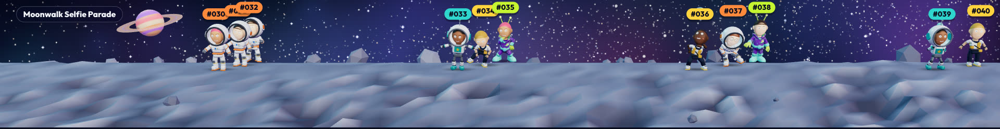

Everything runs **offline on a local network**. There are no cloud services or downloads at runtime. Face detection,
3D characters and the space worlds all run on the event PCs.

> Faces in these screenshots are cartoon stand-ins. At an event, each character wears the guest's real selfie.

---

## Contents

- [How it works](#how-it-works)
- [The guest experience (station)](#the-guest-experience-station)
- [The parade wall](#the-parade-wall)
- [The characters](#the-characters)
- [Quick start](#quick-start)
- [Running an event on several PCs](#running-an-event-on-several-pcs)
- [Pages and URL options](#pages-and-url-options)
- [Calibrating the wall](#calibrating-the-wall)
- [Customising](#customising)
- [3D model pipeline](#3d-model-pipeline)
- [Project structure](#project-structure)
- [Performance](#performance)
- [Guest data and privacy](#guest-data-and-privacy)
- [Troubleshooting](#troubleshooting)

---

## How it works

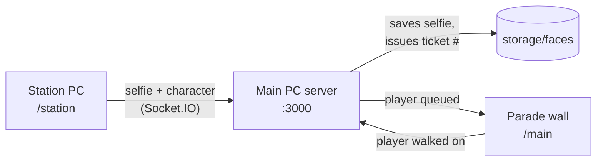

1. **Station:** the guest takes a selfie. The face is detected and aligned on the device (MediaPipe, bundled
   locally), they choose a character in a live 3D preview, and they get a ticket number such as **#042**.
2. **Server:** saves the selfie to `storage/faces/`, issues the ticket number and queues the guest.
3. **Parade wall:** the guest's 3D character walks on wearing their face, with the ticket number floating above it
   so they can find themselves.

---

## The guest experience (station)

<table>
  <tr>
    <td width="50%">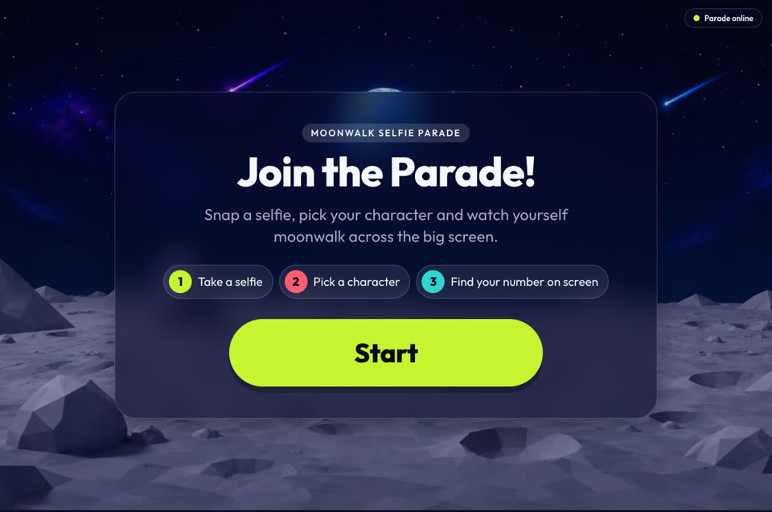</td>
    <td width="50%">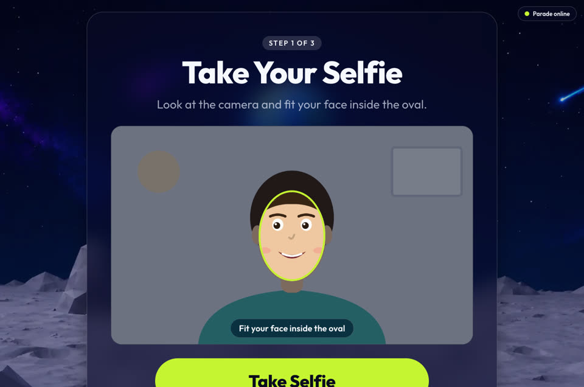</td>
  </tr>
  <tr>
    <td><b>1. Welcome:</b> a big Start button and a three-step explainer.</td>
    <td><b>2. Selfie:</b> mirrored camera, face-guide oval and a 3-2-1 countdown.</td>
  </tr>
  <tr>
    <td>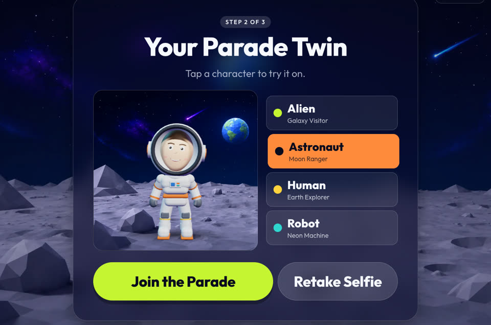</td>
    <td>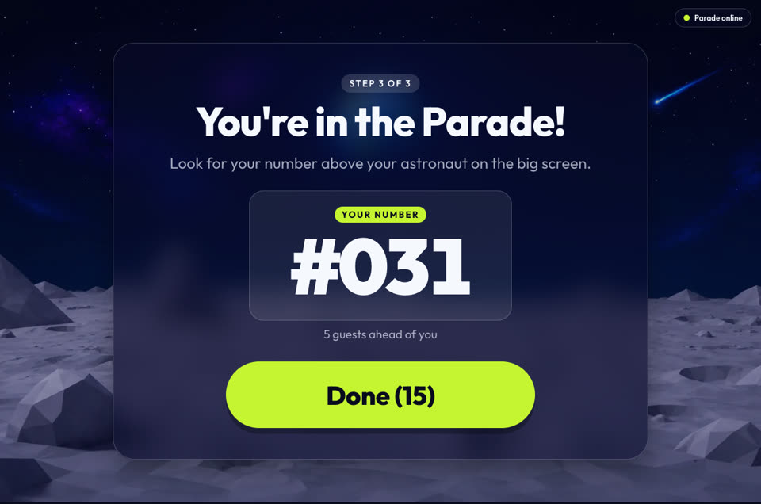</td>
  </tr>
  <tr>
    <td><b>3. Your Parade Twin:</b> a live, turning 3D preview wearing the guest's face. Tap a character to swap instantly.</td>
    <td><b>4. You're in!</b> A big ticket number and how many guests are ahead. Returns to Welcome by itself.</td>
  </tr>
</table>

Built for unattended kiosks:

- **Face alignment.** Every selfie is straightened (eyes level, centred, same size), so faces sit correctly on the 3D
  head even if the guest stands off-centre. If no face is found, the guest is asked to retake or continue anyway.
- **Auto-reset.** Returns to Welcome 15 s after joining, or after 60 s of no touches mid-flow (camera switched off).
- **Connection badge.** Top-right shows *Parade online* or a red *Parade offline - please call staff*.

---

## The parade wall

### Four worlds that keep changing

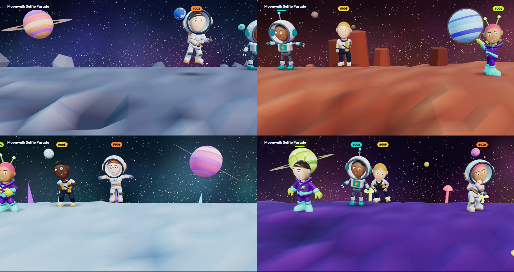

| World | Ground | Scenery | Sky |
|---|---|---|---|
| **The Moon** | grey craters | boulders | violet galaxy, ringed planet, Earth |
| **Mars** | red dunes | tall rock mesas | dusty orange nebula, blue gas giant, two moons |
| **Crystal Planet** | icy blue | glowing teal, pink and purple crystals | teal aurora, pink ringed planet |
| **Neon Jungle** | purple | glowing neon mushrooms | magenta galaxy, lime ringed planet |

All four are drawn in code: twinkling stars, shooting stars, spinning planets, low-poly ground. There are no image
or video files. The wall moves to the next world every **2 minutes** (adjustable) with a quick fade and a
*Next stop* banner:

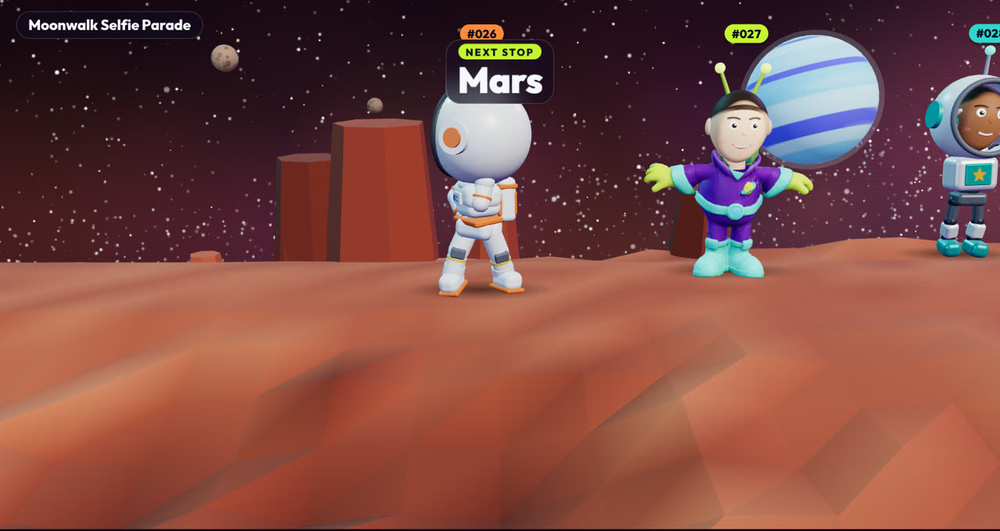

### Dance party

The parade is designed to make people stop and laugh together:

- **Everyone dances differently.** Each character gets its own random dance and tempo and switches every few
  seconds: *funny dance, love pop, pop sway, robot, disco, raise the roof, twist, wave sway, crazy twist*.
- **Spins, hops and wiggles** at random moments, and **bobblehead** selfie heads that wobble more while dancing.
- **Moves on the beat.** The whole parade bobs on one shared beat.
- **"DANCE BREAK!"** every 35–55 s: the parade freezes, everyone hops, busts out their own dance, then spins and
  walks on.

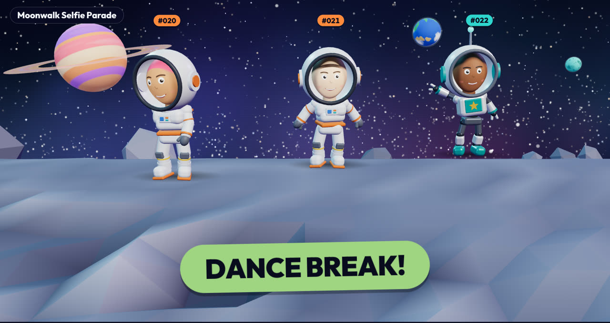

### Made for wide video walls

The camera adapts to any screen shape. On a single 16:9 TV it uses the framing set in calibration; on a 6.4:1 wall
it switches to a longer lens so characters at the edges aren't stretched. Characters enter and leave exactly at the
screen edges, and the wall shows up to 20 characters at once (10 on a single TV).

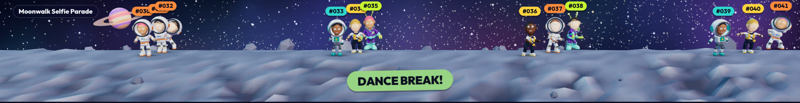

---

## The characters

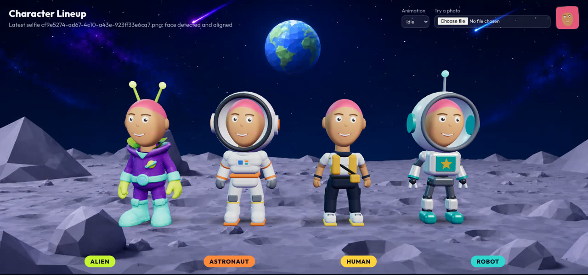

| Character | Body | Head |
|---|---|---|
| **Alien** | sculpted Meshy model: purple suit, teal trim | antennae |
| **Astronaut** | white suit, orange trim, backpack, chest panel | white helmet with a face window |
| **Human** | yellow vest, cross-body bag, cargo trousers, sneakers; arms in the guest's skin tone | guest's own head and hair |
| **Robot** | white body, teal star plate, joints, claw hands | round white head, teal ear discs, antenna |

All four share one skeleton and its idle, wave, dance and pose animations. The guest's selfie is projected onto a
rounded 3D head attached to the skeleton's `Head` bone, with skin and hair colours sampled from their photo.

`/admin` shows all four side by side wearing the latest selfie. Staff can also upload any photo there to preview it.

---

## Quick start

**Requirements:** Node.js **20.19+ or 22.12+**, and a recent Chrome or Edge (or the bundled Electron app).

**macOS:** double-click **`run-all.command`**. It installs packages when needed (including after a `git pull`),
starts the server and the frontend, and opens `/main`, `/station` and `/admin`.

**Windows / manual:**

```bash
npm install
npm run install:all
npm run dev:all
```

Then open:

| Page | URL |
|---|---|
| Parade wall | http://localhost:5173/main |
| Station (kiosk) | http://localhost:5173/station |
| Character lineup | http://localhost:5173/admin |

The server runs on port **3000** and the frontend on **5173**.

---

## Running an event on several PCs

Typical setup: one **main PC** drives the video wall and runs the server; one or more **station PCs** run the kiosk.
All PCs must be on the same network.

1. **On the main PC**, find its local IP (for example `192.168.1.100`), then start everything (`run-all.command` or
   `npm run dev:all`). Open `http://localhost:5173/main` full-screen across the wall.
2. **Allow incoming connections** on ports **5173** and **3000** in the main PC's firewall.
3. **On each station PC**, open `http://192.168.1.100:5173/station?stationId=station-01` (use a different
   `stationId` per kiosk).
4. **Camera permission over the network:** browsers only allow the camera on `https://` or `localhost`. On each
   station PC, open `chrome://flags/#unsafely-treat-insecure-origin-as-secure`, add `http://192.168.1.100:5173`,
   and relaunch Chrome.

Optional settings (`.env`, see `.env.example`):

| Variable | Default | Purpose |
|---|---|---|
| `SERVER_PORT` | `3000` | Server port |
| `MAIN_PC_SERVER_IP` | `192.168.1.100` | Shown in logs and treated as an allowed network origin |
| `MAX_SERVER_QUEUE` | `300` | Guests waiting before new submissions are refused |
| `VITE_SOCKET_URL` | `http://<page host>:3000` | Override the server address the pages connect to |

**Electron kiosk mode (optional):** a full-screen window with no browser UI.

- **On the main PC** (with the frontend running): `npm run dev:electron:main`. Use `dev:electron:station` or
  `dev:electron:admin` for the other pages.
- **On another PC**, from `apps/electron`, point it at the main PC:

  ```bash
  npx cross-env MOONWALK_RENDERER_URL=http://192.168.1.100:5173 MOONWALK_DEFAULT_ROUTE=/station electron .
  ```

  The camera rule from step 4 applies here too, so a browser station with the Chrome flag is the simplest option.

---

## Pages and URL options

| URL | What it does |
|---|---|
| `/main` | The parade wall |
| `/main?debug=1` | Operator panel (connection, queue, settings); press **D** on the wall to toggle it |
| `/main?calibrateCharacter=1` | Calibration page (see below) |
| `/main?worldEvery=20` | Change world every 20 s (testing) |
| `/main?danceBreakEvery=15` | Dance Break every 15 s (testing) |
| `/station?stationId=station-02` | Kiosk, labelled with its station ID |
| `/station?debug=1` | Shows station ID and server address on the kiosk |
| `/admin` | Character lineup with the latest selfie, plus a photo upload to try faces |

---

## Calibrating the wall

Open **`/main?calibrateCharacter=1`** on the wall PC.

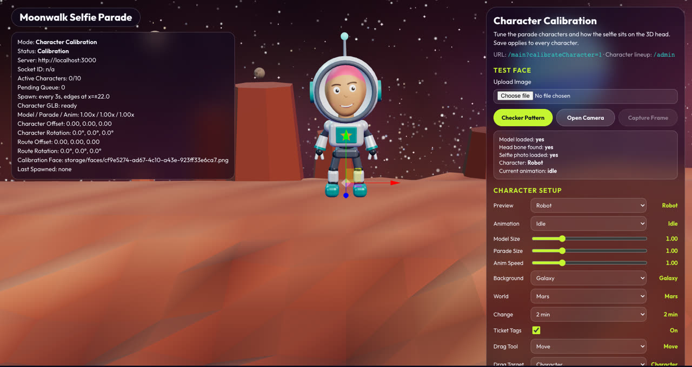

| Section | Controls |
|---|---|
| **Test Face** | upload a photo, use the camera, or a checker pattern to see how faces map onto the head |
| **Character Setup** | preview character and animation, Model Size, **Parade Size** (how big characters are on the wall), Anim Speed |
| **Background** | *Galaxy* (the four worlds) or *Videos* (the playlist in `public/backgrounds/videos/playlist.json`) |
| **World / Change** | preview any world; how often the wall changes world (30 s to 10 min) |
| **Ticket Tags** | show or hide the #number above characters |
| **Drag Tool / Target** | drag the character or the whole parade route directly in the 3D view |
| **Selfie Head** | head size and position on the body, face zoom and face height |
| **Parade Route** | move or turn the whole route to line it up with your screens |

Press **Save** to apply to the wall. Settings are stored in the browser on the wall PC, so calibrate on that PC.

---

## Customising

| To change | Edit |
|---|---|
| Worlds (colours, props, planets) or add a fifth | `apps/frontend/src/components/main/worlds.js` |
| How the worlds are generated | `apps/frontend/src/components/main/GalaxyBackdrop.jsx` |
| Dances and dance layers | `apps/frontend/src/components/avatar/danceMoves.js` |
| Character list, props and materials | `apps/frontend/src/components/avatar/characterVariants.js` |
| Astronaut, Human and Robot body parts | `apps/frontend/src/components/avatar/proceduralBodies.js` |
| Dance Break timing, spawn rate, lane speeds, character size | constants at the top of `apps/frontend/src/pages/MainDisplayPage.jsx` |
| Station text and flow | `apps/frontend/src/pages/StationPage.jsx` |
| Colours, fonts, glass styling | `apps/frontend/src/index.css` (design tokens at the top) |

---

## 3D model pipeline

The Alien is a Meshy model; the full-size exports live in `assets/models/source/`. After replacing them, rebuild the
lightweight runtime files:

```bash
npm run optimize:models
```

This re-encodes the 28 MB texture to a 2048 px JPEG and strips each animation file down to its animation clips,
turning ~145 MB of source into ~1.5 MB served to the browser. Requirements for a replacement model are in
`assets/models/source/alien/README.txt`.

---

## Project structure

```text
apps/
  frontend/                 React + Vite + react-three-fiber
    src/pages/              StationPage, MainDisplayPage (wall + calibration), AdminPage (lineup)
    src/components/avatar/  characters: rig, selfie head, code-built bodies, dances, lighting
    src/components/main/    worlds and the galaxy backdrop
    src/lib/                face alignment, face layout, calibration storage, socket
    public/models/          optimized character + animations, face detection model
  server/                   Express + Socket.IO: queue, selfie storage, ticket numbers
  electron/                 optional kiosk wrapper
assets/
  models/source/            full-size Meshy exports (not served)
  reference/characters/     character concept art
scripts/optimize-models.mjs
storage/faces/              guest selfies (local only, never committed)
docs/images/                README screenshots
```

---

## Performance

Built to run all day on event PCs:

- Character files are about **1.5 MB** in total. The Astronaut, Human and Robot bodies are each one merged mesh
  (one draw call) shared by every guest wearing them.
- Worlds are generated in code. Each is built the first time it appears, and only the current world is drawn.
- Face detection runs once per selfie on the station; the wall only re-checks alignment for each new guest.
- Ticket tags are plain coloured labels (no blur effects) so 20 of them stay cheap.

---

## Guest data and privacy

- Selfies are saved on the main PC in **`storage/faces/`** and are **never committed to git** (see `.gitignore`).
- Ticket numbers persist in `storage/state.json` so a server restart doesn't reuse them.
- Nothing is sent to the internet.
- **To reset between events:** stop the server, clear `storage/faces/` (keep `.gitkeep`) and delete
  `storage/state.json`.

---

## Troubleshooting

| Problem | Fix |
|---|---|
| Station shows **Parade offline** | Check the main PC is running, both PCs are on the same network, and ports 3000/5173 are allowed through the firewall |
| Station camera is black or blocked | Allow camera permission. On another PC, add the Chrome flag from [Running an event](#running-an-event-on-several-pcs) |
| "We could not spot your face clearly" | Better lighting, face the camera, fit the face inside the oval; guests can still continue |
| Characters too small or large on the wall | Calibration, then **Parade Size** |
| Face sits too high or low on the head | Calibration, then **Selfie Head**: Face Up and Face Zoom |
| A new package is missing after `git pull` | Run `npm run install:all` (`run-all.command` does it automatically) |
| Want the old video backgrounds | Calibration, then **Background: Videos** |
